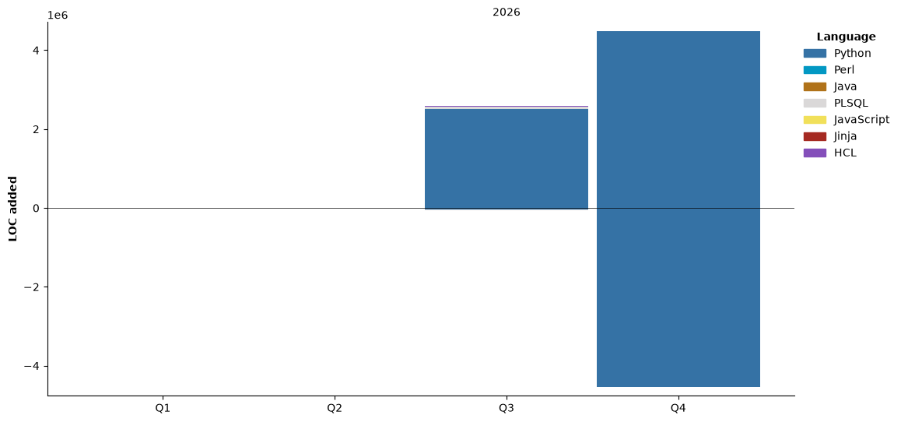

# Ellie Scott

<p align="left">
  
</p>

Software developer focused on agentic AI, MCP integration, and building pragmatic tooling that eliminates operational friction.


<p align="left">
  <a href="https://github.com/ellie-scott?tab=followers">
    
  </a>
  <a href="https://github.com/ellie-scott?tab=repositories">
    
  </a>
  <a href="https://github.com/ellie-scott">
    
  </a>
</p>

---

### Now / Next

- **Building:** Production-ready agents and MCP tools that replace manual enterprise workflows.
- **Improving:** Eval harnesses, context engineering, and output reliability for LLM systems.
- **Sharing:** Spec-Driven Development (SDD) patterns and tooling to help dev teams ship faster.

---

### What I Ship At Work

- Internal apps, custom browser tools, and core workflow automation.
- CI/CD and self-hosted runner pipelines for reliable team delivery.
- Certificate and service integrations that reduce manual ops overhead.
- Production AI tooling—custom MCP servers, agents, and SDD pipelines.
- CI/CD build environments and self-hosted runner infrastructure.
- Cloud infrastructure automation and security platform integrations.

---

### Tech Stack


---

### Live Coding Pulse
  
</p>

<!--START_SECTION:waka-->


**🐱 My GitHub Data** 

> 📦 109.6 kB Used in GitHub's Storage 
 > 
> 🏆 460 Contributions in the Year 2026
 > 
> 🚫 Not Opted to Hire
 > 
> 📜 2 Public Repositories 
 > 
> 🔑 11 Private Repositories 
 > 
**I'm an Early 🐤** 

```text
🌞 Morning                186 commits         ████████░░░░░░░░░░░░░░░░░   30.05 % 
🌆 Daytime                384 commits         ████████████████░░░░░░░░░   62.04 % 
🌃 Evening                47 commits          ██░░░░░░░░░░░░░░░░░░░░░░░   07.59 % 
🌙 Night                  2 commits           ░░░░░░░░░░░░░░░░░░░░░░░░░   00.32 % 
```
📅 **I'm Most Productive on Tuesday** 

```text
Monday                   118 commits         █████░░░░░░░░░░░░░░░░░░░░   19.06 % 
Tuesday                  143 commits         ██████░░░░░░░░░░░░░░░░░░░   23.10 % 
Wednesday                124 commits         █████░░░░░░░░░░░░░░░░░░░░   20.03 % 
Thursday                 116 commits         █████░░░░░░░░░░░░░░░░░░░░   18.74 % 
Friday                   115 commits         █████░░░░░░░░░░░░░░░░░░░░   18.58 % 
Saturday                 3 commits           ░░░░░░░░░░░░░░░░░░░░░░░░░   00.48 % 
Sunday                   0 commits           ░░░░░░░░░░░░░░░░░░░░░░░░░   00.00 % 
```


📊 **This Week I Spent My Time On** 

```text
🕑︎ Time Zone: America/Chicago

💬 Programming Languages: 
Java                     5 hrs 54 mins       ██████░░░░░░░░░░░░░░░░░░░   25.16 % 
Other                    5 hrs 43 mins       ██████░░░░░░░░░░░░░░░░░░░   24.39 % 
Markdown                 4 hrs 11 mins       ████░░░░░░░░░░░░░░░░░░░░░   17.85 % 
Perl                     3 hrs 55 mins       ████░░░░░░░░░░░░░░░░░░░░░   16.74 % 
Text                     1 hr 40 mins        ██░░░░░░░░░░░░░░░░░░░░░░░   07.16 % 

🔥 Editors: 
IntelliJ IDEA            20 hrs 8 mins       █████████████████████░░░░   85.92 % 
Copilot CLI              3 hrs 18 mins       ████░░░░░░░░░░░░░░░░░░░░░   14.08 % 
```

🤖 **AI Coding This Week** 

```text
⏱ AI Coding Time: 22 hrs 19 mins (95.22%)

✍️ 1,324 lines written by AI, 12 lines written by hand (99.1% AI-written)

🔤 26,360,024 Input Tokens, 1,810,889 Output Tokens

💵 $159.97 Estimated AI Cost This Week

🧠 52 AI Sessions, 369 AI Prompts

GPT                      1,258 lines         ███████████████████████░░   91.89 % 
Sonnet                   111 lines           ██░░░░░░░░░░░░░░░░░░░░░░░   08.11 % 
Intellijidea             0 lines             ░░░░░░░░░░░░░░░░░░░░░░░░░   00.00 % 

🔎 AI Coding Insights:
🤖 AI-Driven — 99.1% of written lines came from AI
📝 Concise Prompter — average 392 characters per prompt
🔁 Iterative Prompter — average 7 prompts per session
🚀 High AI Trust — 4.13% of changed lines were hand-edited
```

**I Mostly Code in Python** 

```text
Python                   7 repos             ███████░░░░░░░░░░░░░░░░░░   29.17 % 
Jinja                    6 repos             ██████░░░░░░░░░░░░░░░░░░░   25.00 % 
Shell                    2 repos             ██░░░░░░░░░░░░░░░░░░░░░░░   08.33 % 
JavaScript               1 repo              █░░░░░░░░░░░░░░░░░░░░░░░░   04.17 % 
PLSQL                    1 repo              █░░░░░░░░░░░░░░░░░░░░░░░░   04.17 % 
```


**Timeline**




 Last Updated on 28/11/2026 06:44:11 UTC
<!--END_SECTION:waka-->

